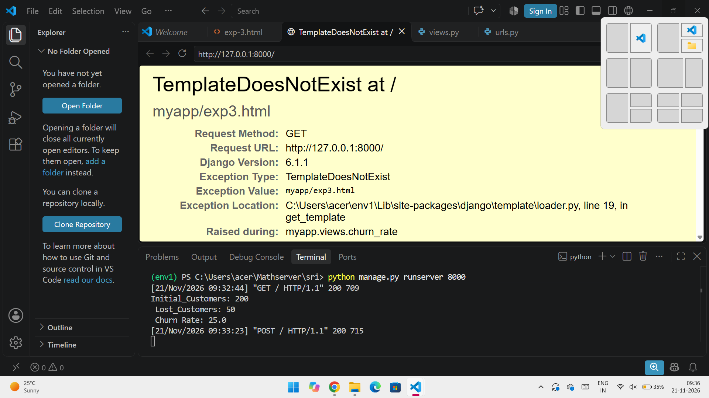
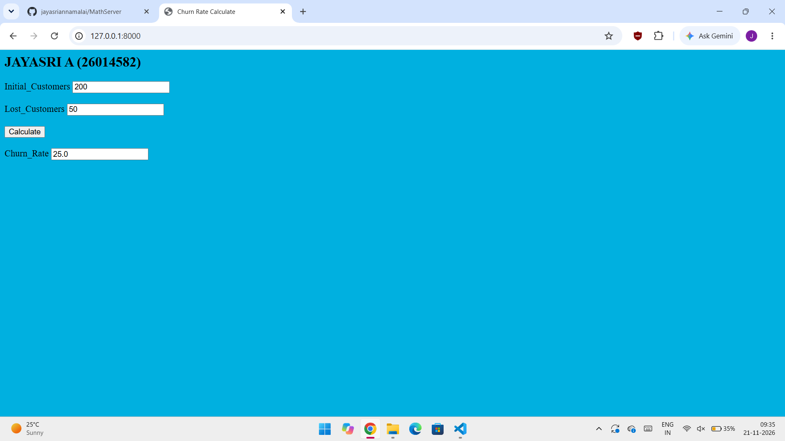

# Ex.03 Design a Website for Server Side Processing
## Date:12.11.2026

## AIM:
To create a web page to calculate Churn Rate using server-side scripts.

## FORMULA:
Churn Rate = (CustLost / InitCust) * 100
<br> InitCust --> Initial Customers Count
<br> CustLost --> Customers Lost Count

## DESIGN STEPS:

### Step 1:
Clone the repository from GitHub.

### Step 2:
Create Django Admin project.

### Step 3:
Create a New App under the Django Admin project.

### Step 4:
Create a HTML file to implement form based input and output.

### Step 5:
Create python programs for views and urls to perform server side processing.

### Step 6:
Receive input values from the form using request.POST.get().

### Step 7:
Calculate the Result using the given formula.

### Step 8:
Display the calculated result in the server console.

### Step 9:
Render the result to the HTML template.

### Step 10:
Publish the website in Localhost.

## PROGRAM:
```
sri.html

<html>
    <head>
        <title>Churn Rate Calculate</title>
    </head>
    <body bgcolor="sky blue">
        <h2>JAYASRI A (26014582)</h2>
        <form method="POST">
            
            <label>Initial_Customers</label>
            <input type="number" name="initialvalue" value="{{iv}}"><br><br>
            <label>Lost_Customers</label>
            <input type="number" name="lostvalue" value="{{lv}}"><br><br>
            <input type="submit" value="Calculate"><br><br>
            <label>Churn_Rate</label>
            <input type="text" value="{{cr}}">
        </form>
    </body>
</html>

views.py

from django.shortcuts import render

def churn_rate(request):
    iv=int(request.POST.get('initialvalue','0'))
    lv=int(request.POST.get('lostvalue','0'))
    cr=(lv/iv)*100 if(request.method=="POST") else 0
    print(f"Initial_Customers: {iv} \n Lost_Customers: {lv} \n Churn Rate: {cr}")
    return render(request, "myapp/sri.html",{"iv": iv, "lv": lv, "cr": cr})
    
urls.py
from django.contrib import admin
from django.urls import path
from myapp import views

urlpatterns=[
    path('',views.churn_rate,name='calculate_churnrate'),
]
```

## OUTPUT - SERVER SIDE:


## OUTPUT - WEBPAGE:


## RESULT:
The the web page to calculate Churn Rate using server-side scripts is created successfully.
